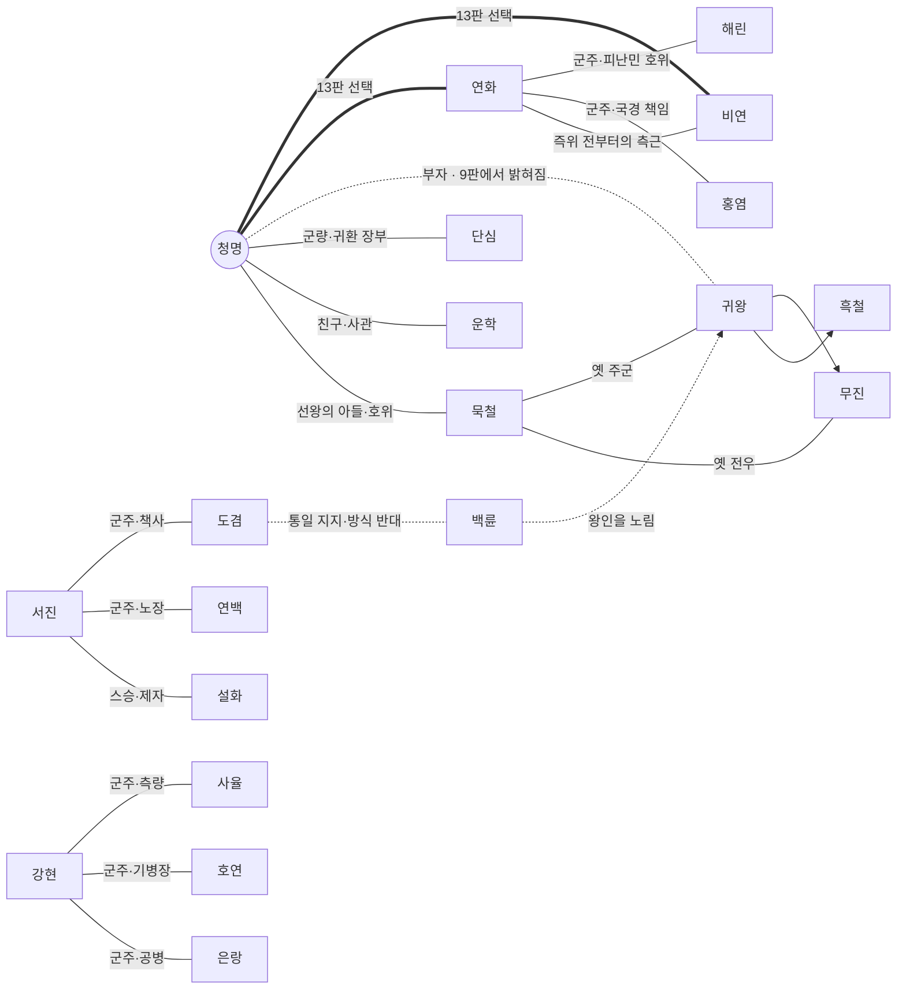

# 사신기 등장인물

> [!WARNING]
> **스포일러 주의.** 이 문서에는 청명 본편 9판·현무편 6판의 정체 반전과 결말이 포함되어 있다.

기준: 2026-10-31 `main`의 게임 데이터(`COMPANIONS`·`FACTION_CHARACTERS`·`RULERS`·`RULER_LORE`·`HERO_SKILLS`·`SAGA_Q/X`)와 [사신기.md](사신기.md) 대본.
대사 수는 대본의 `- 이름 —` 줄을 센 값이다(본편 / 현무편 / 야영지 인연).
**【정리 필요】** 표시는 현재 데이터끼리 맞지 않거나 설정이 비어 있는 곳이다. 고칠 때 이 문서도 함께 고친다.

---

## 목차
1. [개요](#1-개요)
2. [인물 관계도](#2-인물-관계도)
3. [청룡](#3-청룡) — 청명 · 묵철 · 운학 · 단심
4. [현무](#4-현무) — 서진 · 설화 · 연백 · 도겸
5. [백호](#5-백호) — 강현 · 호연 · 은랑 · 사율
6. [주작](#6-주작) — 연화 · 비연 · 홍염 · 해린
7. [귀왕군 · 통일파](#7-귀왕군--통일파) — 귀왕 · 흑철 · 무진 · 백륜
8. [극중 역할 정렬표](#8-극중-역할-정렬표)
9. [말투 일람](#9-말투-일람)
10. [정리 필요 목록](#10-정리-필요-목록)

---

## 1. 개요

네 나라(청룡·현무·백호·주작)와 귀왕군·통일파, 다섯 세력에 각 4명씩 **총 20명**이다. 여성은 단심·설화·강현·사율·연화·비연·해린 7명, 나머지 13명은 남성이다. 각 나라는 **군주 1명 + 장수 3명**으로 짜여 있다.

| 세력 | 군주 | 장수 | 왕인에 대한 입장 |
|---|---|---|---|
| 청룡 | **청명** | 묵철 · 운학 · 단심 | 파괴 |
| 현무 | **서진** | 설화 · 연백 · 도겸 | 연구 |
| 백호 | **강현** | 호연 · 은랑 · 사율 | 통제 |
| 주작 | **연화** | 비연 · 홍염 · 해린 | 방어에 쓸 수 있다면 사용 |
| 귀왕군·통일파 | **귀왕** | 흑철 · 무진 · 백륜 | 명령 수행 / 탈취(백륜) |

- **플레이 시점**: 청명 본편 16판, 서진(현무) 보조편 10판. 백호·주작 시점은 본편 중간의 짧은 「군주 시점」 대화 장면으로만 나온다.
- **국가 소속과 출진 편성은 별개다.** 다른 나라 장수도 합류해 청명의 부대를 이끈다.

---

## 2. 인물 관계도

---

## 3. 청룡

### 청명
> 「왕인은 누구의 전리품도 아닙니다. 함께 보고, 함께 부숩시다.」

| 항목 | 내용 |
|---|---|
| 소속 | 청룡 · 군주 |
| 성별 | 남성 |
| 병종 | 군주(방패 호위 12표식 동행) |
| 등장 | 본편 전 판 / 현무편 x2·x3 언급, x6 |
| 대사 수 | 59 / 1 / 6 |
| 도술 | 청룡강림 · 회복진 |
| 외모 | 푸른빛이 도는 검은 장발, 청록색 눈, 옥 귀걸이 |

#### 개요
청룡의 젊은 왕이자 **본편의 주인공**. 망자군에게 쫓겨난 사람들을 보고, 그 군대를 움직이는 **왕인(王印)** 을 부수기로 한다. 「승리는 통일이 아니라 병사들의 귀환」이 목표다. 아버지인 선왕과 다른 방식으로 사람을 지키고 싶어 한다.

#### 작중 행적
- **기(1~4판)**: 버들골을 지키다 왕인의 규칙을 알게 된다. 현무 국경에서 충돌하지만 북문을 함께 지켜 길을 연다.
- **승(5~8판)**: 백호와 길을 두고 싸우다 끊긴 다리를 함께 고친다. 주작에 늦게 보낸 원군 문제를 사과하고, 직접 주작성 남문을 지킨다.
- **전(9~12판)**: 혼령곡에서 **귀왕이 아버지라는 사실**을 알게 된다. 청룡성에서 「얼굴을 보고 칼을 들 자신이 없다」고 털어놓고 묵철에게 곁을 부탁한다. 현무 연구소와 백호 공방의 구출을 돕는다.
- **결(13~16판)**: 혼인 제안을 두고 연화·비연 중 한 사람을 택한다. 네 나라가 전선을 나눠 맡고, 귀왕성에서 아버지의 왕인을 부순다.

#### 인물 관계
- **묵철**: 아버지의 호위. 처음엔 선왕과 비교당하지만, 정체가 밝혀진 뒤에는 가장 의지하는 사람이 된다.
- **연화·비연**: 13판의 선택 대상.
- **귀왕**: 아버지. 끝까지 아들을 알아보지 못한다.

#### 말투
대부분 존댓말(합쇼·해요)을 쓰고 부하에게도 「~세요」라고 한다. 비연에게만 7판부터 반말을 쓴다.

#### 【정리 필요】
- **존댓말과 반말이 기준 없이 섞인다.** 13판 「혼자 기대하게 한 건 제 잘못이야. 더 미루지 않겠습니다.」처럼 한 대사 안에서도 섞인다. 군주가 부하에게 쓰는 말투, 동급 군주에게 쓰는 말투, 비연에게 쓰는 말투의 규칙을 정해야 한다.
- 13판의 핵심 동기 「아버지의 죄를 갚으려는 혼인」이 그 전에 한 번도 나오지 않는다.
- 감정을 직접 말하는 대사가 많다(「무섭습니다」, 「두려웠습니다」).

---

### 묵철
> 「이번에는 네 결정을 믿겠다.」

| 항목 | 내용 |
|---|---|
| 소속 | 청룡 · 방패대장 |
| 성별 | 남성 |
| 병종 | 방패병 |
| 등장 | 1판부터 동행 |
| 대사 수 | 18 / 1 / 3 |
| 기술 | 묵철 철벽 — 「방패 뒤로. 살아서 돌아간다.」 |
| 외모 | 희끗한 머리, 짧은 수염, 얼굴의 흉터. 나이 든 무인 |

#### 개요
**선왕의 옛 호위.** 청명을 어릴 때부터 지켜본 어른으로, 처음엔 선왕의 방식으로 청명을 재단한다. 귀왕의 정체를 청명과 함께 확인한 뒤 「청명 자신의 결정」을 믿게 된다. 본편에서 **청명의 감정선을 받쳐 주는 가장 중요한 조연**이다.

#### 작중 행적
- 1~8판: 전술 조언과 방패진으로 퇴로를 연다. 현무 북문에서 연백의 부상병을 데려온다.
- 9판: 갈라진 면갑 아래 얼굴을 보고 칼을 내린다. 「……선왕 폐하.」 다가가는 청명을 붙잡아 물러난다.
- 10판: 「그분께 다시 칼을 겨누기가 두렵다」고 털어놓고, 끝까지 곁을 지키겠다고 약속한다.
- 15판: 옛 전우 무진과 성문 앞에서 맞선다.
- 16판: 왕인이 부서진 뒤 무릎 꿇은 청명 곁에서 말없이 기다린다.
- 야영지 인연 「네 결정을 믿는다」: 갈라진 방패 끈을 함께 고친다.

#### 말투
반말·해라체. 청명을 이름으로 부른다. 짧고 무뚝뚝하다.

#### 【정리 필요】
- ✅ 해결(2026-10-31): 선왕이 「청명을 데리고 돌아가라」고 명령해 마지막을 보지 못했다. c10에서 고백한다(STORY.md 「선왕의 마지막 원정」).
- 예전 설정(「누구에게도 충성하지 않는 호위」, 「왕관을 피해 도망친 사람」)이 HANDOFF 기록에 남아 있다. 현행 설정은 「선왕의 충직한 호위」다.

---

### 운학
> 「듣기 싫은 사실도 기록하겠습니다.」

| 항목 | 내용 |
|---|---|
| 소속 | 청룡 · 궁병 지휘관 · 사관 |
| 성별 | 남성 |
| 병종 | 궁병 |
| 등장 | 1판부터 동행 |
| 대사 수 | **4** / 0 / 0 |
| 기술 | 청연 일제사격 — 「활을 들어라. 한 번에, 같은 곳을.」 |
| 외모 | 흰 가닥이 섞인 검은 장발, 회색 눈. 차분한 얼굴 |

#### 개요
청명의 친구이자 **사관(史官)**. 왕을 지키기 위해서라도 사실을 지우지 않는다는 인물이다. 귀왕의 정체는 청명과 함께 알게 된다.

#### 작중 행적
- 1판: 적이 남긴 군적에서 왕인의 존재를 찾아내고 규칙을 설명한다.
- 9판: 귀왕에게 다가가는 청명을 말린다.
- 15판: 왕인을 노리고 뛰어드는 백륜을 막으려 소리친다.

#### 말투
해요체. 설명하는 역할의 대사가 대부분이다.

#### 【정리 필요】
- ✅ 일부 해결(2026-10-31): 사관으로서 반전의 복선(c1 원정군 군적, c6 어의 기록 없는 장례 기록)과 c9 해설을 맡는다. 대사는 아직 적은 편.
- 예전 「즉위 기록을 고쳐 쓴 사관」 설정은 폐기됐다. 현행 소개문은 「사실을 지우지 않는다」다.

---

### 단심
> 「승전보보다 돌아올 사람 수부터 말해 주세요.」

| 항목 | 내용 |
|---|---|
| 소속 | 청룡 · 창병 지휘관 · 군량 담당 |
| 성별 | 여성 |
| 병종 | 창병 |
| 등장 | 1판부터 동행 / 현무편 x9 |
| 대사 수 | 7 / 1 / 3 |
| 기술 | 벽뢰 창진 — 「창끝을 세워요. 아무도 뒤로 넘기지 않습니다.」 |
| 외모 | 단발 갈색 머리, 적갈색 눈 |

#### 개요
병사의 이름·군량·귀환 날짜를 기록하는 실무자. 무리한 작전에는 군주에게도 반대한다. 본편에서는 **병사들의 생활(치료·편지·귀환)** 을 대변한다.

#### 작중 행적
- 1판: 주민 서른두 명을 구출하다 손을 다치고도 모른다.
- 10판: 「혼자 결정하고 혼자 싸우실 필요는 없어요」라며 청명을 붙잡는다.
- 14·16판: 보급로 개통과 생존 병사 집결을 보고한다.
- 야영지 인연 「돌아올 날짜」: 병사들의 편지를 모아 청명에게 답장을 쓰게 한다.

#### 말투
해요체. 부드럽지만 할 말은 한다.

#### 【정리 필요】
- ✅ 해결: x9의 단심 대사를 청룡성 수비대 서술로 바꿨다.
- 「군주에게도 반대한다」는 소개와 달리, 실제로 청명에게 반대하는 장면이 없다.

---

## 4. 현무

### 서진
> 「내 판단에 반대하는 제자도 내 제자일세.」

| 항목 | 내용 |
|---|---|
| 소속 | 현무 · 군주(학자 군주) |
| 성별 | 남성 |
| 병종 | 군주 |
| 등장 | 본편 c3·c4·c10·c11·c14 / **현무편 주인공** |
| 대사 수 | 14 / 35 / 3 |
| 외모 | 은발 장발, 둥근 금테 안경, 푸른 눈 |

#### 개요
현무의 학자 군주이자 **현무편의 주인공**. 북문 병력이 모자라 망자군의 명령을 바꿔 쓰는 **왕인 연구**에 매달린다. 제자 설화의 반대를 듣지 않다가 사상자를 낸 뒤 연구를 멈추고 실패를 공개한다. 「틀린 어른이 책임지는 법」을 보여 주는 인물이다.

#### 작중 행적
- 본편 c3: 국경을 넘는 청룡군을 막는다. c4: 북문을 함께 지킨 뒤 국경을 열면서 「조사할 기회」를 조건으로 건다.
- 본편 c11 / 현무편 x7: 연구소 폭주로 병사들이 갇힌다. 실험을 멈추고 실패와 자신이 내린 명령을 공개한다.
- 현무편 x5: 주작에 원군을 늦게 보낸 것을 사과한다.
- 현무편 x6: 귀왕의 정체를 알고 「그렇다고 우리 병사들을 죽인 일을 잊을 수는 없네」라고 말한다.
- 현무편 x10: 돌아오지 못한 병사들의 소식을 직접 전하겠다고 한다.

#### 말투
하게체(「~네」, 「~게」). 등장인물 중 말투가 가장 뚜렷하다.

#### 【정리 필요】
- 「명령은 바뀌지 않는다」는 규칙이 처음부터 공개되어 있어, 명령을 바꾸려는 연구가 시작부터 헛수고로 보인다. 연구가 왜 가능해 보였는지 근거가 필요하다.

---

### 설화
> 「군주님께 배운 판단으로 반대하는 겁니다.」

| 항목 | 내용 |
|---|---|
| 소속 | 현무 · 궁병 지휘관 · 서진의 제자 |
| 성별 | 여성 |
| 병종 | 궁병 |
| 합류 | 본편 c4 이후 |
| 대사 수 | 8 / 14 / 3 |
| 기술 | 지운 흔적 — 「지운 자리를 노립니다.」 |
| 외모 | 은발 장발, 머리 장식, 회청색 눈 |

#### 개요
서진의 제자이자 연구원. **스승을 존경하기 때문에 위험한 실험에 반대한다.** 사과만으로는 돌아가지 않고 실험 중단과 실패 공개를 요구한다. 현무편의 실질적인 갈등 상대다.

#### 작중 행적
- 본편 c4: 「산 사람을 실험에 쓰지 않는다」는 약속을 지키겠다며 청명과 동행한다.
- c11·x7: 갇힌 동료들의 명단을 들고 구조를 이끈다. 「아직은 화가 납니다」라며 바로 용서하지 않는다.
- 야영지 인연 「반대를 기록하다」: 자신이 반대한 내용도 연구 기록에 남긴다.

#### 말투
합쇼·해요체. 단호하다.

#### 【정리 필요】
- 기술 이름 「지운 흔적」은 폐기된 「지운 일기」 설정에서 나왔다. 현행 인물과 맞지 않는다.

---

### 연백
> 「연구가 끝날 때까지 버티라는 명령으로 병사를 묻었습니다.」

| 항목 | 내용 |
|---|---|
| 소속 | 현무 · 방패대장 · 북쪽 국경 책임자 |
| 성별 | 남성 |
| 병종 | 방패병 |
| 합류 | 본편 c4 이후 |
| 대사 수 | 7 / 12 / 0 |
| 기술 | 성문 앞에 남는 자 — 「다친 자는 뒤로. 나는 여기 남는다.」 |
| 외모 | 흰 머리와 땋은 흰 수염. 노장 |

#### 개요
연구가 진행되는 동안 **실제로 성문을 지키는 노장.** 연구의 가능성보다 오늘의 전사자를 먼저 보는 현장의 목소리다. c11에서 부하 셋의 전사를 보고해 서진의 변화를 밀어붙인다.

#### 말투
하오체(「~소」, 「~오」).

#### 【정리 필요】
- 서진을 압박하는 역할인데, 장면 대부분에서 보고와 수비 지시만 한다.

---

### 도겸
> 「한 나라가 되는 편이 낫다고 공개적으로 말하겠습니다.」

| 항목 | 내용 |
|---|---|
| 소속 | 현무 · 책사 · 외교 담당 |
| 성별 | 남성 |
| 병종 | 궁병 |
| 합류 | 없음(대화로만 등장) |
| 대사 수 | 2 / 3 / 0 |
| 외모 | 흐트러진 검은 머리, 회색 눈 |

#### 개요
통일파의 논리를 **공개적으로 지지하는** 현무의 책사. 비밀 배신자가 아니다. 통일은 원하지만, 사람을 버리고 실패를 감추는 백륜의 방식에는 반대한다. 「통일파가 단일 악당 집단이 아님」을 보여 주는 장치다.

#### 작중 행적
- c3·x1: 통일파의 연구 지원을 받자고 건의한다.
- c11: 실패 공개에 동의한다.
- x8: 「그래도 백륜의 방식은 따를 수 없다」며 갈라선다. 실험을 계속하자고 했던 자기 책임도 인정한다.

#### 말투
합쇼체.

#### 【정리 필요】
- ✅ c3과 x1 대사 중복 해결.
- 「통일이 왜 필요한가」에 대한 이 인물만의 이유(경험, 잃은 것)가 없다.

---

## 5. 백호

### 강현
> 「장치보다 사람을 먼저 구한다. 오늘은 내 설계도 예외가 아니야.」

| 항목 | 내용 |
|---|---|
| 소속 | 백호 · 군주(발명가) |
| 성별 | 여성 |
| 병종 | 군주 |
| 등장 | c5·c6·c12·c14 / x4·x8 |
| 대사 수 | 15 / 3 / 0 |
| 외모 | 백금발에 금빛 머리 장식, 황금 눈 |

#### 개요
백호의 발명가 군주. **왕인을 통제하면 살아 있는 병사를 더 보내지 않아도 된다**고 믿는다. 은랑·사율·호연은 그 희망이 오늘 치르게 하는 비용을 묻는다. 기술자가 다친 뒤 직접 찾아가 책임지는 군주다.

#### 작중 행적
- c5: 서량에서 청룡군을 막는다. 「조사도 하기 전에 부수지는 마.」
- c5 뒤·c6: 망자군이 다리를 끊자 휴전하고 공병대를 보낸다. 다친 청룡 병사도 자기 의관에게 보낸다.
- c12: 백륜이 공방을 점거하자 장치를 지키라던 명령을 취소한다. 「내가 만든 것보다 저 사람들이 중요해.」
- c14: 귀왕성 성문을 열 장치를 운반한다.

#### 말투
반말(해체). 다른 군주들보다 거리낌 없이 말한다.

---

### 호연
> 「병사를 아끼겠다는 말로 병사를 버리지 마십시오.」

| 항목 | 내용 |
|---|---|
| 소속 | 백호 · 돌격기병장 |
| 성별 | 남성 |
| 병종 | 기병 |
| 합류 | 본편 c5 이후 |
| 대사 수 | **3** / 0 / 0 |
| 기술 | 맹호 돌격 — 「길 열어! 백호가 지나간다!」 |
| 외모 | 갈색 장발, 콧등의 흉터 |

#### 개요
군주의 왕인 연구에 반대하는 기병장. 청명과 충돌한 뒤 공동 보급로 전투를 거치며 신뢰를 쌓는다.

#### 작중 행적
- c5: 「이대로면 서로 칠 수밖에 없습니다」라며 양쪽을 말린다. 전투 뒤 다리까지 길을 안내한다.
- c12: 「장치를 지키라는 이전 명령은 취소하시는 겁니까?」

#### 【정리 필요】
- 「연구에 반대한다」는 소개와 달리, 대사에서는 반대하는 장면이 거의 없다.
- 예전 설정(「귀왕군에 들어간 아버지를 찾는 기병」, 「다리를 저는 갑주」)은 폐기됐다. 현행 대사에는 남아 있지 않다.

---

### 은랑
> 「장치보다 안의 사람부터 구하겠습니다.」

| 항목 | 내용 |
|---|---|
| 소속 | 백호 · 공병 · 창병 지휘관 |
| 성별 | 남성 |
| 병종 | 창병 |
| 합류 | 본편 c6 이후 |
| 대사 수 | 9 / 2 / 0 |
| 기술 | 황동 기관창 — 「실패한 손이라도 창은 돌린다!」 |
| 외모 | 헝클어진 금발, 머리에 얹은 고글, 얼굴의 그을음. 황동 의수(설정) |

#### 개요
황동 의수를 쓰는 기술자. 왕인 장치의 실패를 숨기지 않고, 군주에게 안전한 철수 계획부터 요구한다. **백호 쪽의 실질적인 갈등 상대**로, 현무의 설화와 대칭을 이룬다.

#### 작중 행적
- c5 군주 시점: 장치 실패로 기술자가 다쳤다고 보고한다.
- c6: 다리를 고치고, 손을 다친 동료의 이야기를 들어 달라고 강현에게 요구한다.
- c12: 「설계도는 타도 돼요. 먼저 사람을 데려와야 합니다.」 철수 계획을 이끈다.

#### 말투
해요체.

---

### 사율
> 「지도 위의 길에도 사람이 삽니다.」

| 항목 | 내용 |
|---|---|
| 소속 | 백호 · 측량기병장 · 보급로 담당 |
| 성별 | 여성 |
| 병종 | 기병 |
| 합류 | 본편 c5 이후 |
| 대사 수 | **3** / 0 / 0 |
| 기술 | 측량 질주 — 「지름길은 내가 그려 두었소.」 |
| 외모 | 짙은 피부, 검은 머리, 노란 목도리 |

#### 개요
진군로와 우물, 피난길을 함께 그리는 기병장. 큰 계획이 놓치는 사람들을 군주에게 보여 준다.

#### 작중 행적
- c5: 「서쪽 우물에는 피난민이 모여 있소.」
- c12: 왕인 없이도 병사들이 쉴 수 있도록 교대와 보급을 정하자고 제안한다.

#### 말투
하오체.

#### 【정리 필요】
- 대사가 3줄뿐이다. 「측량」이라는 직업을 살린 장면이 없다.

---

## 6. 주작

### 연화
> 「혼인과 상관없이 동맹은 지킵니다.」

| 항목 | 내용 |
|---|---|
| 소속 | 주작 · 여왕 |
| 성별 | 여성 |
| 병종 | 군주 |
| 등장 | c2(시점)·c7·c8·c13·c14 / x5 |
| 대사 수 | 17 / 3 / 0 |
| 외모 | 검은 장발, 붉은 눈, 루비 귀걸이와 붉은 장신구 |

#### 개요
타국을 먹이는 곡창의 주인이지만 정작 자기 나라 국경은 무너지고 있는 여왕. **13판 선택 대상 중 한 명**이다. 같은 사람을 좋아하게 된 오랜 측근 비연을 명령으로 물러서게 하지 않는다. 「사랑받고 싶은 마음」과 「나라의 약속」을 따로 책임진다.

#### 작중 행적
- c2 시점: 청룡에 쌀을 보내며 비연을 걱정한다.
- c7: 원군이 늦자 남화에서 청명을 직접 만나 따진다.
- c8: 「당신까지 잃은 줄 알았어요.」 처음으로 감정을 드러낸다.
- c13: 비연에게 먼저 마음을 털어놓은 뒤 혼인 제안서를 보낸다. 청명이 나라에 미안해서 혼인하려 한다면 거절한다.
- c14: 군량을 맡는다. 「먹는 것도 잠드는 것도 잊지 마세요.」

#### 말투
청명에게는 존댓말(해요), 부하에게는 해라·반말(「~해라」, 「~하자」).

#### 【정리 필요】
- **청명과 직접 만나는 장면이 c7·c8·c13 세 번뿐이다.** c8의 고백은 감정이 너무 급하다.
- 13판 선택이 c14~c16의 대사를 바꾸지 않는다(결말 문단만 다름).

---

### 비연
> 「지는 날에도 돌아와요. 기다리는 건 승전보가 아니니까.」

| 항목 | 내용 |
|---|---|
| 소속 | 주작 · 전령 · 기병 지휘관 |
| 성별 | 여성 |
| 병종 | 기병 |
| 합류 | 본편 c2 |
| 대사 수 | 18 / 0 / 0 |
| 기술 | 비룡 질풍 — 「바람보다 먼저 닿을게요!」 |
| 외모 | 구릿빛 갈색 머리, 초록 눈, 청록 깃털 귀걸이 |

#### 개요
연화가 즉위하기 전부터 곁에 있던 전령. **13판 선택 대상 중 한 명.** 청명을 좋아하지만 자기 나라 사람들과 여왕을 버릴 수 없다. 전장을 함께 다니며 청명과 가장 먼저 가까워진다.

#### 작중 행적
- c2: 주작의 군량선을 지키며 청명의 상처에 붕대를 감는다.
- c7: 「청명, 여기서 대답해 주세요.」 원군이 늦은 일로 곤란해진다.
- c8: 연화와 청명 사이에서 「치료부터 받아야겠어요」라며 자리를 뜬다.
- c13: 혼인 제안서를 직접 전한다. 「청명이 다른 사람과 함께 살게 되는 건 싫어요.」

#### 말투
해요체.

#### 【정리 필요】
- **청명 호칭이 「청명 님」과 「청명」 사이에서 흔들린다.**
- 기병 지휘관이지만 전투 대사는 거의 없고, 안내·치료·식사 장면이 대부분이다.

---

### 홍염
> 「우리 창고를 비우면서 남의 전쟁까지 먹일 수는 없소.」

| 항목 | 내용 |
|---|---|
| 소속 | 주작 · 창병대장 · 국경 책임자 |
| 성별 | 남성 |
| 병종 | 창병 |
| 합류 | 본편 c8 이후 |
| 대사 수 | **3** / 1 / 0 |
| 기술 | 거절의 종 — 「종이 울린다. 멈춰라!」(주변 적 기절) |
| 외모 | 적갈색 머리, 얼굴을 가로지르는 붉은 흉터 |

#### 개요
주작의 병사와 식량을 지키는 장수. 타국 지원에 반대하지만, 약속한 원군이 오면 같은 줄에서 싸운다.

#### 작중 행적
- c7: 「내 부하들이 그동안 전사했소. 언제까지 기다리란 말이오?」
- c8: 남문을 함께 지킨다.

#### 말투
하오체.

#### 【정리 필요】
- 기술 「거절의 종」은 폐기된 「침묵을 동의로 셌던 제관」 설정에서 나왔다.
- 7판의 반발 이후 마음이 바뀌는 장면이 없다.

---

### 해린
> 「지원이 끊기면 아이들이 먼저 굶습니다.」

| 항목 | 내용 |
|---|---|
| 소속 | 주작 · 궁병 지휘관 · 피난민 호위 |
| 성별 | 여성 |
| 병종 | 궁병 |
| 합류 | 본편 c8 이후 |
| 대사 수 | 5 / 2 / 0 |
| 기술 | 두 사람 몫의 화살 — 「두 사람 몫으로 쏘겠습니다.」 |
| 외모 | 자줏빛 머리, 옆으로 묶은 머리와 장식 |

#### 개요
피난길의 마지막 수레를 지키는 궁사. 홍염과 논쟁하지만 적이 오면 함께 길목을 지킨다.

#### 작중 행적
- c2 시점: 「여왕님도요. 밤마다 항구 보고를 기다리시는 거 알아요.」
- c8: 아이들을 태운 마지막 수레를 들인다.
- x5: 피난 수레가 들어오는 데 「아흔 초」가 필요하다고 알린다.

#### 【정리 필요】
- 기술 이름 「두 사람 몫의 화살」은 폐기된 비연 설정(「두 사람 몫의 밥」)에서 나왔다.
- 소개문의 「홍염과 논쟁」 장면이 대본에 없다.

---

## 7. 귀왕군 · 통일파

### 귀왕
> 「사신국을 하나로 통일하라.」

| 항목 | 내용 |
|---|---|
| 소속 | 귀왕군 · 망자 군주 |
| 성별 | 남성 |
| 병종 | 적장(보스) |
| 등장 | c9·c14·c16 / x6 |
| 대사 수 | 5 / 1 / 0 (대사는 두 종류뿐) |
| 외모 | 얼굴까지 가린 검은 갑주, 보랏빛 눈구멍 |

#### 개요
검은 갑주에 얼굴이 가려진 망자 군주. 왕인에 남은 마지막 명령에 따라 군대를 진군시킨다.
**정체: 청명의 아버지이자 청룡의 선왕.** 청명 본편 9판·현무편 6판에서 같은 사건으로 처음 드러나며, 이 작품의 유일한 반전이다.

#### 작중 행적
- c9: 면갑이 갈라져 얼굴이 드러난다. 아들을 알아보지 못하고 「청룡의 깃발은 왜 진군하지 않느냐」만 되묻는다.
- c14 시점: 무진의 보고에도 같은 두 마디만 반복한다.
- c16: 청명에게 쓰러지고, 왕인이 부서지며 멈춘다.

#### 말투
명령형 두 문장만 반복한다(의도된 연출).

#### 【정리 필요】
- ✅ 해결(2026-10-31): 청룡의 관습대로 **왕이 먼저 자기 왕인에 맹세**해 함께 묶였다(c9 운학). 진군을 멈춘 청룡을 탈영한 깃발로 보아 청룡 마을부터 친다(c1). 복선 c1·c4·c6 추가.
- 16판까지 한 번도 흔들리지 않아 감정의 정점이 없다. 명령은 그대로 두고 한순간만 반응하는 방법을 검토해 볼 만하다.

---

### 흑철
> 「진군……계속…….」

| 항목 | 내용 |
|---|---|
| 소속 | 귀왕군 · 망자 선봉장 |
| 성별 | 남성 |
| 병종 | 기병(적장) |
| 적장 출전 | c1·c2·c6·c8·c13·c14 / x1·x4·x5·x9·x10 |
| 대사 수 | **1** / 0 / 0 |
| 외모 | 검은 머리, 투구, 호박색 눈, 얼굴의 흉터 |

#### 개요
생전에 선왕의 선봉을 맡았던 장군. 남은 명령에 따라 망자군을 이끈다. **쓰러뜨려도 다시 일어나 계속 선봉으로 나오는** 반복 적장이다. 「베는 것만으로는 끝나지 않는다」는 규칙을 몸으로 보여 준다.

#### 【정리 필요】
- 가장 많이 싸우는 적장(10회)인데 대사가 1줄이다. 다시 일어난다는 사실을 아군이 알아차리는 대사도 c14 하나뿐이다.
- 초상은 살아 있는 사람처럼 보인다. 망자 표현이 필요한지 검토해야 한다.

---

### 무진
> 「성문을 지켜라. 왕의 명령은 끝나지 않았다.」

| 항목 | 내용 |
|---|---|
| 소속 | 귀왕군 · 귀왕성 수성장(**산 사람**) |
| 성별 | 남성 |
| 병종 | 방패병(적장) |
| 적장 출전 | c4·c11·c15 / x3·x7 |
| 대사 수 | 4 / 1 / 0 |
| 외모 | 회색 머리, 청록 두건, 염소수염, 푸른 눈 |

#### 개요
묵철과 같은 시대에 싸웠던 성문 지휘관. 귀왕성 앞에서 옛 전우 묵철과 맞선다. 「우리와 함께 그분을 지켜라.」

#### 【정리 필요】
- ✅ 해결(2026-10-31): **산 사람**. 맹세하지 않았지만 망자가 된 주군을 떠나지 못해 십 년째 성문을 지킨다(c15).
- ✅ 해결: x10 북문 적장은 흑철로 바꿨고, c15는 「혼령곡 끝 관문」으로 정리했다.

---

### 백륜
> 「왕 하나가 다스리면 이 싸움도 마지막일 것입니다.」

| 항목 | 내용 |
|---|---|
| 소속 | 통일파 수장 · **살아 있는 인간** |
| 성별 | 남성 |
| 병종 | 창병(적장) |
| 적장 출전 | c10·c12 / x8 |
| 대사 수 | **3** / 0 / 0 |
| 외모 | 은회색 머리, 금빛 눈, 백금색 관복 |

#### 개요
처음부터 왕인을 빼앗아 통일하겠다고 공언하는 정치가. 귀왕의 병력을 이용하려 한다. **최종 국면의 인간 적대자**다.

#### 작중 행적
- c9: 혼령곡에서 왕인을 넘기라고 요구한다.
- c10: 망자군을 청룡성으로 유인해 압박한다.
- c12: 설계도를 넘기지 않는 백호의 공방을 점거한다.
- c15: 성문이 열리자 왕인을 노리고 먼저 들어간다.
- c16: 왕인에 새 명령을 새기려다 실패하고 **망자군에게 끌려간다(서술 한 줄).**

#### 【정리 필요】
- ✅ 해결(2026-10-31): 선왕 원정을 설계한 참모. 「끝내지 못하면 그날 죽은 병사들은 헛되이 죽은 것」(c10).
- **마지막 순간이 화면 밖 서술 한 줄로 처리된다.**
- 귀왕의 명령(통일)과 백륜의 목표가 같은데, 이 연결을 쓰지 않는다. 예: 선왕의 옛 신하라는 설정.
- 세력 표기가 `faction:'gui'`라서 귀왕군과 같은 소속으로 묶여 있다. 「살아 있는 통일파」라는 점이 데이터에 드러나지 않는다.

---

## 8. 극중 역할 정렬표

| 서사 기능 | 인물 | 현재 상태 |
|---|---|---|
| 주인공 | 청명(본편) · 서진(현무편) | 작동 |
| 멘토 / 정서적 버팀목 | 묵철 | 작동(본편 핵심 조연) |
| 연애 · 선택 | 연화 · 비연 | 작동하지만 쌓아 가는 과정이 짧음 |
| 내부 반대자(양심) | 설화(현무) · 은랑(백호) · 연백(현무 현장) | 작동 |
| 내부 반대자(양심) | 단심(청룡) · 호연(백호) · 홍염(주작) | **소개에만 있고 대사에는 거의 없음** |
| 실무 · 생활 | 단심(군량·편지) · 해린(피난민) · 사율(보급로) | 단심만 작동 |
| 기록 · 진실 | 운학 | **비어 있음** |
| 반대 정치 노선 | 도겸(공개 통일 지지) | 일부 작동, 고유 동기 없음 |
| 거울(같은 고민의 다른 답) | 서진(연구) · 강현(통제) · 연화(사용) | 작동하지만 한 장 만에 화해 |
| 비극의 대상 | 귀왕 | 반전은 작동, 감정의 정점 없음 |
| 반복 위협 | 흑철 | 장치로만 작동 |
| 과거의 거울 | 무진(묵철의 옛 전우) | 15판에만 작동, 정체 불명 |
| 인간 적대자 | 백륜 | **동기와 결말 모두 약함** |

---

## 9. 말투 일람

| 말투 | 인물 |
|---|---|
| 하게체(「~네」, 「~게」) | 서진 |
| 하오체(「~소」, 「~오」) | 연백 · 홍염 · 사율 |
| 반말·해라체 | 묵철 · 강현 · 무진 · 귀왕(명령형) |
| 합쇼체 | 도겸 · 호연 · 백륜 · 설화(일부) |
| 해요체 | 운학 · 단심 · 은랑 · 해린 · 비연 · 설화 |
| 혼합 | 청명(존댓말 중심, 비연에게 반말) · 연화(청명에게 해요, 부하에게 해라·반말) |

해요체 인물이 6명이라 이름을 가리면 구분이 어렵다. 인물마다 말버릇이나 어휘 하나씩을 정하는 것을 권한다.

---

## 10. 정리 필요 목록

**사실 충돌 (대사만 고치면 됨)**
1~6. ✅ 해결(2026-10-31)
   - x9 단심 대사 → 청룡성 수비대 서술(단심은 c14·c16 전선).
   - x10 북문 적장 무진 → 빙설에서 쓰러졌다 다시 일어난 흑철(무진은 c15에서 쓰러짐).
   - c15는 「혼령곡 끝, 귀왕성으로 들어가는 마지막 관문」.
   - x3을 현무 북문으로 옮겨 c4와 같은 전투의 다른 시점으로 정리(청룡은 지휘관 격파, 현무는 80초 버티기).
   - c6↔x4 협곡 양쪽 출구, c8↔x5 주작성 남문(청룡)·북문(현무)으로 나눠 서로 언급. c11↔x7 연구소도 양쪽 출입구.
   - x7 제목 「닫힌 연구소의 문」, x1 도겸 대사 교체(통일파의 조건: 연구 기록 전부).

**데이터에 남은 옛 설정**
7. 기술 이름: 설화 「지운 흔적」, 홍염 「거절의 종」, 해린 「두 사람 몫의 화살」 → 현행 인물에 맞게 개명.
8. 도움말(HELP) 「진행」 탭에 「4막 13장」, 「기억 하나를 바친다」, 「여름의 세 갈래」 같은 폐기된 설명이 남아 있음.
9. 백륜이 `faction:'gui'`로 묶여 있어, 귀왕군과 통일파가 데이터에서 구분되지 않음.

**설정 공백 (결정이 필요함)**
10~13. ✅ 확정(2026-10-31): STORY.md 「선왕의 마지막 원정」 참고.
14. 운학의 역할(사관 설정을 살릴지, 다른 역할을 줄지).
15. ~~성별~~ 확정(2026-10-31): 여성 단심·설화·강현·사율·연화·비연·해린, 나머지 남성. 나이는 아직 없음.
