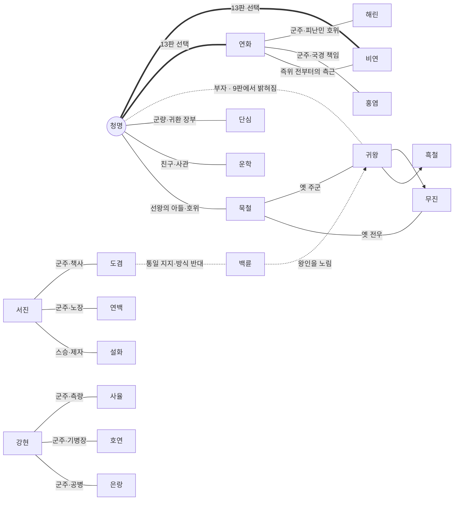

# 사신기 등장인물

> [!WARNING]
> **스포일러 주의.** 이 문서에는 청명 본편 9판·현무편 6판의 정체 반전과 결말이 포함되어 있다.

기준: 2026-11-10 병합 main `c3f689b`에서 개정한 게임 데이터(`COMPANIONS`·`FACTION_CHARACTERS`·`RULERS`·`RULER_LORE`·`HERO_SKILLS`·`SAGA_Q/X`)와 [사신기.md](사신기.md) 대본.
대사 수는 게임의 pre·post·pov와 두 선택의 lines를 센 값이다(본편 / 현무편 / 야영지 인연). 조건 분기 두 갈래를 모두 세므로 한 번의 플레이에서 읽는 수와 다르다.
**【정리 필요】** 표시는 현재 데이터끼리 맞지 않거나 설정이 비어 있는 곳이다. 고칠 때 이 문서도 함께 고친다. 소개·인용·대사 수는 2026-11-10 개정 기준이며, 아래 과거 검토 메모와 작중 행적의 인용은 당시 표현을 포함한다.

---

## 목차
1. [개요](#1-개요)
2. [인물 관계도](#2-인물-관계도)
3. [청룡](#3-청룡) — 청명 · 묵철 · 운학 · 단심
4. [현무](#4-현무) — 서진 · 설화 · 연백 · 도겸
5. [백호](#5-백호) — 강현 · 호연 · 은랑 · 사율
6. [주작](#6-주작) — 연화 · 비연 · 홍염 · 해린
7. [귀왕군 · 통일파](#7-귀왕군--통일파) — 귀왕 · 흑철 · 무진 · 백륜
8. [극중 역할 정렬표](#8-극중-역할-정렬표)
9. [말투 일람](#9-말투-일람)
10. [정리 필요 목록](#10-정리-필요-목록)

---

## 1. 개요

네 나라(청룡·현무·백호·주작)와 귀왕군·통일파, 다섯 세력에 각 4명씩 **총 20명**이다. 여성은 단심·설화·강현·사율·연화·비연·해린 7명, 나머지 13명은 남성이다. 각 나라는 **군주 1명 + 장수 3명**으로 짜여 있다.

| 세력 | 군주 | 장수 | 왕인에 대한 입장 |
|---|---|---|---|
| 청룡 | **청명** | 묵철 · 운학 · 단심 | 파괴 |
| 현무 | **서진** | 설화 · 연백 · 도겸 | 연구 |
| 백호 | **강현** | 호연 · 은랑 · 사율 | 통제 |
| 주작 | **연화** | 비연 · 홍염 · 해린 | 방어에 쓸 수 있다면 사용 |
| 귀왕군·통일파 | **귀왕** | 흑철 · 무진 · 백륜 | 명령 수행 / 탈취(백륜) |

- **플레이 시점**: 청명 본편 16판, 서진(현무) 보조편 10판. 백호·주작 시점은 본편 중간의 짧은 「군주 시점」 대화 장면으로만 나온다.
- **국가 소속과 출진 편성은 별개다.** 다른 나라 장수도 합류해 청명의 부대를 이끈다.

---

## 2. 인물 관계도

---

## 3. 청룡

### 청명
> 「아직 창고에 사람이 있다. 돌아갈 사람은 다 데리고 간다.」

| 항목 | 내용 |
|---|---|
| 소속 | 청룡 · 군주 |
| 성별 | 남성 |
| 병종 | 군주(방패 호위 12표식 동행) |
| 등장 | 본편 전 판 / 현무편 x2·x3 언급, x6 |
| 대사 수 | 112 / 6 / 9 |
| 도술 | 청룡강림 · 회복진 |
| 외모 | 푸른빛이 도는 검은 장발, 청록색 눈, 옥 귀걸이 |

#### 개요
청룡의 젊은 왕, 청명. 보고를 듣다가도 다친 사람이 있다는 말에 먼저 자리에서 일어나 묵철에게 붙들린다. 도움을 청한 이에게 쉽게 등을 돌리지 못하지만, 그 때문에 자기 성을 비운다는 단심의 말에도 대답해야 한다. 망자들을 막기만 해서는 버들골 사람들이 다시 쫓겨날 것을 안다. 왕인을 부수러 가는 길은 거기서 시작됐다.

#### 작중 행적
- **기(1~4판)**: 버들골을 지키다 왕인의 규칙을 알게 된다. 현무 국경에서 충돌하지만 북문을 함께 지켜 길을 연다.
- **승(5~8판)**: 백호와 길을 두고 싸우다 끊긴 다리를 함께 고친다. 주작에 늦게 보낸 원군 문제를 사과하고, 직접 주작성 남문을 지킨다.
- **전(9~12판)**: 혼령곡에서 **귀왕이 아버지라는 사실**을 알게 된다. 청룡성에서 「얼굴을 보고 칼을 들 자신이 없다」고 털어놓고 묵철에게 곁을 부탁한다. 현무 연구소와 백호 공방의 구출을 돕는다.
- **결(13~16판)**: 혼인 제안을 두고 연화·비연 중 한 사람을 택한다. 네 나라가 전선을 나눠 맡고, 귀왕성에서 아버지의 왕인을 부순다.

#### 인물 관계
- **묵철**: 아버지의 호위. 처음엔 선왕과 비교당하지만, 정체가 밝혀진 뒤에는 가장 의지하는 사람이 된다.
- **연화·비연**: 13판의 선택 대상.
- **귀왕**: 아버지. 끝까지 아들을 알아보지 못한다.

#### 말투
자기 신하에게는 짧은 해라체, 묵철에게는 하오체, 다른 나라 군주에게는 합쇼체. 비연에게는 c6까지 하오체, c7의 사과부터 반말로 가까워진다. 급할 때는 설명보다 먼저 할 일을 말한다. 감정 장면에서도 연설처럼 자기 마음을 정리하지 않고, 묻던 말을 멈추거나 상대에게 작은 부탁을 한다.

#### 【정리 필요】
- ✅ 해결(2026-10-31): 말투 규칙을 정하고(위 「말투」, 아래 9절 호칭 표), 어긋난 대사 7줄을 고쳤다. 13판 섞인 대사는 비연(반말)·연화(존댓말)에게 따로 말하는 두 줄로 나눴다.
- 13판의 핵심 동기 「아버지의 죄를 갚으려는 혼인」이 그 전에 한 번도 나오지 않는다.
- ✅ 개정(2026-11-10): 감정 요약을 줄이고 멈춘 질문·행동 지시·작은 부탁으로 바꿨다.

---

### 묵철
> 「턱 당겨. 왕이라고 화살이 비켜 가는 건 아니니까.」

| 항목 | 내용 |
|---|---|
| 소속 | 청룡 · 방패대장 |
| 성별 | 남성 |
| 병종 | 방패병 |
| 등장 | 1판부터 동행 |
| 대사 수 | 66 / 6 / 3 |
| 기술 | 묵철 철벽 — 「방패 뒤로. 살아서 돌아간다.」 |
| 전투 특성 | **호위의 맹세**: 군주(청명·서진)가 300 안에 있으면 군주가 받는 피해 −30% |
| 외모 | 희끗한 머리, 짧은 수염, 얼굴의 흉터. 나이 든 무인 |

#### 개요
선왕의 호위였고, 이제는 그 아들 청명의 앞에서 방패를 든다. 왕 앞에서도 말이 짧고 잔소리가 길다. 청명이 제 뜻을 말할 때마다 옛 주군을 떠올리지만, 정작 위험해지면 누구보다 먼저 그를 감싼다. 낡은 방패를 바꾸라는 말은 못 들은 척한다.

#### 작중 행적
- 1~8판: 전술 조언과 방패진으로 퇴로를 연다. 현무 북문에서 연백의 부상병을 데려온다.
- 9판: 갈라진 면갑 아래 얼굴을 보고 칼을 내린다. 「……선왕 폐하.」 다가가는 청명을 붙잡아 물러난다.
- 10판: 「그분께 다시 칼을 겨누기가 두렵다」고 털어놓고, 끝까지 곁을 지키겠다고 약속한다.
- 15판: 옛 전우 무진과 성문 앞에서 맞선다.
- 16판: 왕인이 부서진 뒤 무릎 꿇은 청명 곁에서 말없이 기다린다.
- 야영지 인연 「네 결정을 믿는다」: 갈라진 방패 끈을 함께 고친다.

#### 최후
**15판에서 전사.** 귀왕성 관문에서 다시 일어난 무진과 망자들을 막고 「이번엔 내가 남는다. 명령이 아니라 내가 고른 거다」라며 청명을 혼자 보낸다. 무진과 서로를 붙잡은 채 쓰러진다. 16판부터 편성에서 빠진다. 10판에 운학의 공개 기록을 막다가, 14판에 「그분 이야기는 네가 쓰는 대로 두마」로 화해한다.

#### 말투
반말·해라체. 청명을 이름으로 부른다. 짧고 무뚝뚝하다.

#### 【정리 필요】
- ✅ 해결(2026-10-31): 선왕이 「청명을 데리고 돌아가라」고 명령해 마지막을 보지 못했다. c10에서 고백한다(STORY.md 「선왕의 마지막 원정」).
- 예전 설정(「누구에게도 충성하지 않는 호위」, 「왕관을 피해 도망친 사람」)이 HANDOFF 기록에 남아 있다. 현행 설정은 「선왕의 충직한 호위」다.

---

### 운학
> 「날짜가 안 맞습니다. 누가 잘못 적은 건지부터 보겠습니다.」

| 항목 | 내용 |
|---|---|
| 소속 | 청룡 · 궁병 지휘관 · 사관 |
| 성별 | 남성 |
| 병종 | 궁병 |
| 등장 | 1판부터 동행 |
| 대사 수 | 44 / 0 / 4 |
| 기술 | 청연 일제사격 — 「활을 들어라. 한 번에, 같은 곳을.」 |
| 전투 특성 | **사관의 기록**: 출진해 살아 있으면 적 증원 경보 +10초, 적장 돌진·화살비 예고 +1초 |
| 외모 | 흰 가닥이 섞인 검은 장발, 회색 눈. 차분한 얼굴 |

#### 개요
청명과 어릴 때부터 함께 자란 사관 겸 궁병 지휘관. 군막에서도 젖은 종이부터 말리고, 왕이 한 말도 날짜 옆에 그대로 적는다. 틀린 글자를 발견하면 상대가 누구든 묻고 넘어간다. 다만 선왕의 장례 기록에 찍힌 스승의 이름 앞에서는, 자꾸만 질문을 삼킨다.

#### 작중 행적
- 1판: 망자들의 군적에서 왕인과 「십여 년 전 청룡 원정군」 부대 이름을 찾아낸다. 「지켜 낸 서른두 명의 이름까지」 적겠다고 한다.
- 6판: 선왕 장례 기록에 어의의 진료 기록이 없다는 걸 발견한다. 그 기록을 쓴 사관이 자기 스승이라고 털어놓는다.
- 9판: 청룡의 「왕이 먼저 맹세하는 관습」을 설명하고, 스승의 「병으로 붕어」가 거짓이었음을 받아들인다.
- 10판: 선왕이 귀왕이 되었다는 사실까지 **있는 그대로 공개 기록하겠다**고 청명에게 말한다. 청명은 「감당은 제가 하겠습니다」라고 답한다. 이 공개가 c11 서진 시점의 「청명 님은 숨기지 않았어요」로 이어진다.
- 14판: 쓰러진 흑철도 원정군 명부에 적어 「집으로 돌려보낼 수 있게」 한다.
- 15판: 왕인을 노리고 뛰어드는 백륜을 막으려 소리친다.
- 16판: 「마지막 장은 비워 두지 않겠다」며 돌아온 사람과 돌아오지 못한 사람의 이름을 모두 적는다.
- 야영지 인연 「고치지 않는 기록」(12판 뒤): 스승의 글씨를 보며, 청명이 원망받게 되더라도 고치지 않겠다고, 대신 청명이 무엇을 두려워하고 누구에게 사과했는지도 적겠다고 약속한다.

#### 말투
해요체. 청명을 이름으로 부른다(어릴 적 친구).

#### 【정리 필요】
- ✅ 해결(2026-10-31): 스승의 거짓 기록이라는 개인 사연과 공개 기록 결심(c6→c9→c10), 인연 장면, 14·16판 대사로 역할을 키웠다. 대사 4줄→15줄+인연 4줄.
- 예전 「즉위 기록을 고쳐 쓴 사관」 설정은 폐기됐다. 현행은 「스승이 쓴 거짓을 고치지 않고 바로잡는 사관」이다.

---

### 단심
> 「두 부대요? 그럼 성벽에는 누굴 세우시게요?」

| 항목 | 내용 |
|---|---|
| 소속 | 청룡 · 창병 지휘관 · 군량 담당 |
| 성별 | 여성 |
| 병종 | 창병 |
| 등장 | 1판부터 동행 / 현무편 x9 |
| 대사 수 | 46 / 0 / 3 |
| 기술 | 벽뢰 창진 — 「창끝을 세워요. 아무도 뒤로 넘기지 않습니다.」 |
| 전투 특성 | **군량 장부**: 출진해 살아 있으면 군량 수입 +3/초 |
| 외모 | 단발 갈색 머리, 적갈색 눈 |

#### 개요
청룡군의 창병과 군량을 맡는다. 출진 명단을 들고 다니며 빠진 사람을 찾고, 무리한 명령에는 장부를 펴 놓고 왕과 따진다. 병사들이 쉬는 틈에도 남의 몫까지 일을 챙기는 바람에 늘 늦게 잔다. 청명이 제 밥을 덜겠다고 하면 그때만은 대답도 듣지 않는다.

#### 작중 행적
- 1판: 주민 서른두 명을 구출하다 손을 다치고도 모른다.
- 10판: 「혼자 결정하고 혼자 싸우실 필요는 없어요」라며 청명을 붙잡는다.
- 14·16판: 보급로 개통과 생존 병사 집결을 보고한다.
- 야영지 인연 「돌아올 날짜」: 병사들의 편지를 모아 청명에게 답장을 쓰게 한다.

#### 말투
해요체. 부드럽지만 할 말은 한다.

#### 【정리 필요】
- ✅ 해결: x9의 단심 대사를 청룡성 수비대 서술로 바꿨다.
- ✅ 해결(2026-11-02): 7판에서 원군 파견에 정면 반대, 10판 「그때 제가 말렸잖아요」, 16판 묵철의 빈자리를 메운다.

---

## 4. 현무

### 서진
> 「그럼 성벽에서 사흘째 못 잔 병사에게도, 기다리라고 해야 하나?」

| 항목 | 내용 |
|---|---|
| 소속 | 현무 · 군주(학자 군주) |
| 성별 | 남성 |
| 병종 | 군주 |
| 등장 | 본편 c3·c4·c10·c11·c14 / **현무편 주인공** |
| 대사 수 | 25 / 79 / 3 |
| 외모 | 은발 장발, 둥근 금테 안경, 푸른 눈 |

#### 개요
현무의 학자 군주, 서진. 설명할 때면 책의 빈 곳에 도해를 그리며 제자에게 하듯 차근차근 말한다. 하지만 북문 전사자 보고가 올 때마다 왕인 연구를 서두른다. 망자가 성문을 지키면 산 병사들이 잘 수 있으리라 믿는다. 가장 아끼는 제자 설화가 그 연구를 막아설 때, 그는 유난히 말을 길게 한다.

#### 작중 행적
- 본편 c3: 국경을 넘는 청룡군을 막는다. c4: 북문을 함께 지킨 뒤 국경을 열면서 「조사할 기회」를 조건으로 건다.
- 본편 c11 / 현무편 x7: 연구소 폭주로 병사들이 갇힌다. 실험을 멈추고 실패와 자신이 내린 명령을 공개한다.
- 현무편 x5: 주작에 원군을 늦게 보낸 것을 사과한다.
- 현무편 x6: 귀왕의 정체를 알고 「그렇다고 우리 병사들을 죽인 일을 잊을 수는 없네」라고 말한다.
- 현무편 x10: 돌아오지 못한 병사들의 소식을 직접 전하겠다고 한다.

#### 말투
하게체(「~네」, 「~게」). 등장인물 중 말투가 가장 뚜렷하다.

#### 【정리 필요】
- ✅ 해결(2026-11-01): 규칙1을 「아무도 시험해 본 적 없는 옛말」로 낮추고, 연구는 명령을 바꾸는 게 아니라 **덧새기기**를 노린 것으로 정리했다. c11·c12·c16의 실패가 옛말을 증명한다.

---

### 설화
> 「폐하, 제 말 끝까지 듣고 대답하세요. 어제도 중간에 끊으셨잖아요.」

| 항목 | 내용 |
|---|---|
| 소속 | 현무 · 궁병 지휘관 · 서진의 제자 |
| 성별 | 여성 |
| 병종 | 궁병 |
| 합류 | 본편 c4 이후 |
| 대사 수 | 25 / 47 / 3 |
| 기술 | 설화 일점사 — 「기록해 둔 약점, 한 곳만 노립니다.」 |
| 전투 특성 | **기록된 약점**: 설화 부대의 공격은 방패병의 정면 화살 감소를 무시 |
| 외모 | 은발 장발, 머리 장식, 회청색 눈 |

#### 개요
서진에게 글과 활을 배운 현무의 궁병 지휘관. 연구실에서는 제자들의 잘못된 계산을 짚어 주고, 성벽에서는 화살이 어디에 꽂혔는지 확인한다. 스승을 닮고 싶어 밤늦게까지 남곤 했지만, 요즘은 그를 설득하느라 더 늦게 돌아간다. 틀렸다고 생각한 일에는 고개를 숙이지 않는다.

#### 작중 행적
- 본편 c4: 「산 사람을 실험에 쓰지 않는다」는 약속을 지키겠다며 청명과 동행한다.
- c11·x7: 갇힌 동료들의 명단을 들고 구조를 이끈다. 「아직은 화가 납니다」라며 바로 용서하지 않는다.
- 야영지 인연 「반대를 기록하다」: 자신이 반대한 내용도 연구 기록에 남긴다.

#### 말투
합쇼·해요체. 단호하다.

#### 【정리 필요】
- ✅ 해결(2026-10-31): 기술을 「설화 일점사」로 개명.

---

### 연백
> 「내일 교대한다는 말, 어제도 들었소.」

| 항목 | 내용 |
|---|---|
| 소속 | 현무 · 방패대장 · 북쪽 국경 책임자 |
| 성별 | 남성 |
| 병종 | 방패병 |
| 합류 | 본편 c4 이후 |
| 대사 수 | 24 / 51 / 0 |
| 기술 | 성문 앞에 남는 자 — 「다친 자는 뒤로. 나는 여기 남는다.」 |
| 전투 특성 | **노장의 버팀**: 연백 부대의 사기 손실 −50% |
| 외모 | 흰 머리와 땋은 흰 수염. 노장 |

#### 개요
현무 북문을 오래 지킨 방패대장. 성벽 틈보다 부하들 절뚝거리는 걸음을 먼저 알아본다. 무릎이 성치 않아도 교대 시간이면 문 위에 올라와 있고, 군주 앞에서도 수비대 사정을 빼놓지 않는다. 묵철과 만나면 말끝마다 시비가 붙는다. 그래도 위험한 쪽 방패는 서로에게 맡긴다.

#### 말투
하오체(「~소」, 「~오」).

#### 【정리 필요】
- 서진을 압박하는 역할인데, 장면 대부분에서 보고와 수비 지시만 한다.

---

### 도겸
> 「좋은 뜻인 건 압니다. 그래서 병사를 몇이나 빼실 겁니까?」

| 항목 | 내용 |
|---|---|
| 소속 | 현무 · 책사 · 외교 담당 |
| 성별 | 남성 |
| 병종 | 궁병 |
| 합류 | 없음(대화로만 등장) |
| 대사 수 | 4 / 36 / 0 |
| 전투 특성 | **책사의 계산**: 무너진 적 부대가 다시 모이기까지 +3초 |
| 외모 | 흐트러진 검은 머리, 회색 눈 |

#### 개요
현무의 책사이자 외교 담당. 국경이 마을을 둘로 가르는 곳에서 자라 네 나라의 통일을 지지한다. 값과 조건을 따지는 말투 탓에 냉정하다는 소리를 듣지만, 손해 보는 계산을 빼놓고 군주를 기쁘게 하지는 않는다. 백륜과 뜻이 통하는 대목도 있고, 결코 받아들일 수 없는 대목도 있다.

#### 작중 행적
- c3·x1: 통일파의 연구 지원을 받자고 건의한다.
- c11: 실패 공개에 동의한다.
- x8: 「그래도 백륜의 방식은 따를 수 없다」며 갈라선다. 실험을 계속하자고 했던 자기 책임도 인정한다.

#### 말투
합쇼체.

#### 【정리 필요】
- ✅ c3과 x1 대사 중복 해결.
- ✅ 현행: 국경선 때문에 고향 마을의 우물까지 갈라졌던 경험을 x8 전투 후에 말한다.

---

## 5. 백호

### 강현
> 「여기만 고치면 돼. 봐, 멈추던 축이 돌아가잖아.」

| 항목 | 내용 |
|---|---|
| 소속 | 백호 · 군주(발명가) |
| 성별 | 여성 |
| 병종 | 군주 |
| 등장 | c5·c6·c12·c15·c16 / x4 (x8·x10 언급) |
| 대사 수 | 32 / 8 / 0 |
| 외모 | 백금발에 금빛 머리 장식, 황금 눈 |

#### 개요
백호의 발명가 군주, 강현. 손에 기름을 묻힌 채 회의에 들어오고, 새 설계가 떠오르면 사람을 붙들고 밤새 설명한다. 왕인의 명령을 바꿔 병사 대신 망자에게 성문을 맡기려 한다. 고장 난 장치는 몇 번이고 고쳐 왔다. 그러나 사람이 다친 실험까지 다음번 성공으로 만회할 수 있는지는, 좀처럼 따져 보려 하지 않는다.

#### 작중 행적
- c5: 서량에서 청룡군을 막는다. 「조사도 하기 전에 부수지는 마.」
- c5 뒤·c6: 망자군이 다리를 끊자 휴전하고 공병대를 보낸다. 다친 청룡 병사도 자기 의관에게 보낸다.
- c5 시점: 「한 번만 더 해 볼 거야.」 c6: 「멈출게. 왕인을 찾기 전까지는.」(복선)
- c12: 백륜에게 설계도를 넘기고 공방을 내준다. 기술자들을 밤낮없이 부리게 두고, 호연에게 「청룡 말고 내 명령을 들어」라고 한다. 구출이 끝나기 전에 장치를 싣고 떠난다(「왕인은 내가 쥔다. 막지 마.」).
- c14: 군주 자리가 빈다. 사율·호연이 대신 백호를 이끈다.
- c15: 백륜과 함께 귀왕성에 먼저 뛰어든다. 「이번엔 내가 망자들을 멈출 거야. 아무도 안 죽게!」
- c16 전투 전: 덧새기기 장치가 터져 쓰러진다. 호연의 품에서 「내가 틀렸어. 왕인은…… 네가 부숴」, 은랑에게 사과를 남기고 숨진다.
- 현무편 x8: 통일파에게 공방 문을 열어 준다. x10: 왕인 곁에서 쓰러졌다는 소식.

#### 말투
반말(해체). 다른 군주들보다 거리낌 없이 말한다.

---

### 호연
> 「폐하 명이라도, 저 안에 제 병사들 가족이 있습니다.」

| 항목 | 내용 |
|---|---|
| 소속 | 백호 · 돌격기병장 |
| 성별 | 남성 |
| 병종 | 기병 |
| 합류 | 본편 c5 이후 |
| 대사 수 | 25 / 0 / 0 |
| 기술 | 맹호 돌격 — 「길 열어! 백호가 지나간다!」 |
| 전투 특성 | **선봉 돌격**: 호연 부대 기병 돌격 피해 +25% |
| 외모 | 갈색 장발, 콧등의 흉터 |

#### 개요
백호의 돌격기병장. 목소리가 커서 말보다 먼저 도착했다는 소리를 듣는다. 강현이 새 장치를 꺼내면 일단 감탄부터 하고, 고장 난 수레를 보면 말에서 내려 함께 민다. 군주를 믿고 따르는 데 익숙한 사람이라, 명령과 눈앞의 병사 사이에서 고르는 일은 유난히 서툴다.

#### 작중 행적
- c5: 「이대로면 서로 칠 수밖에 없습니다」라며 양쪽을 말린다. 전투 뒤 다리까지 길을 안내한다.
- c12: 장치를 지키라는 강현의 명령을 처음으로 거부한다. 「제 병사들은 저 공방 사람들의 아들딸입니다.」 「마지막엔 제가 모셔 오겠습니다.」
- c14~c15: 빈 군주 자리 대신 백호 기병을 이끈다. 「칼보다 말을 먼저 건네겠습니다.」
- c16: 쓰러진 강현을 품에 안고 눈을 감긴 뒤 백호 깃발로 덮는다. 결말에서 강현을 고향 공방 뒤에 묻는다.

#### 【정리 필요】
- ~~반대 장면 부족~~ 2026-11-06 강현 비극으로 충성과 거부 사이의 갈등이 생겼다.
- 예전 설정(「귀왕군에 들어간 아버지를 찾는 기병」, 「다리를 저는 갑주」)은 폐기됐다. 현행 대사에는 남아 있지 않다.

---

### 은랑
> 「움직인다고 다 고친 건 아닙니다. 안에서 갈리는 소리, 들리시죠?」

| 항목 | 내용 |
|---|---|
| 소속 | 백호 · 공병 · 창병 지휘관 |
| 성별 | 남성 |
| 병종 | 창병 |
| 합류 | 본편 c6 이후 |
| 대사 수 | 25 / 15 / 0 |
| 기술 | 황동 기관창 — 「실패한 손이라도 창은 돌린다!」 |
| 전투 특성 | **공병**: 은랑 부대가 성문·목표 구조물에 주는 피해 +60% |
| 외모 | 헝클어진 금발, 머리에 얹은 고글, 얼굴의 그을음. 황동 의수(설정) |

#### 개요
황동 의수로 공구를 쥐는 백호의 공병. 말하다가도 헐거운 바퀴가 보이면 먼저 쪼그려 앉는다. 강현의 발상을 실제로 움직이는 장치로 만드는 일을 오래 맡아 왔다. 누가 다친 실험인지도 그가 가장 잘 안다. 군주의 설명이 길어질수록 은랑의 대답은 짧아진다.

#### 작중 행적
- c5 군주 시점: 장치 실패로 기술자가 다쳤다고 보고한다.
- c6: 다리를 고치고, 손을 다친 동료의 이야기를 들어 달라고 강현에게 요구한다.
- c12: 「설계도는 타도 돼요. 먼저 사람을 데려와야 합니다.」 철수 계획을 이끈다.

#### 말투
해요체.

---

### 사율
> 「그 길은 수레가 못 가오. 말 타고 가 봤소, 직접.」

| 항목 | 내용 |
|---|---|
| 소속 | 백호 · 측량기병장 · 보급로 담당 |
| 성별 | 여성 |
| 병종 | 기병 |
| 합류 | 본편 c5 이후 |
| 대사 수 | 14 / 0 / 0 |
| 기술 | 측량 질주 — 「지름길은 내가 그려 두었소.」 |
| 전투 특성 | **측량**: 사율이 있는 보급소는 2배 빨리 확보 |
| 외모 | 짙은 피부, 검은 머리, 노란 목도리 |

#### 개요
백호의 측량기병장. 남들이 진군로에 선을 그을 때 우물과 여울, 수레가 돌아설 자리를 표시한다. 직접 다녀오지 않은 길은 지도에 비워 둔다. 호연의 급한 성미를 놀리면서도 그가 돌아올 길부터 살핀다. 강현에게도 말은 조용히 하지만, 길을 비켜 달라는 부탁에는 쉽게 물러서지 않는다.

#### 작중 행적
- c5: 「서쪽 우물에는 피난민이 모여 있소.」
- c12: 왕인 없이도 병사들이 쉴 수 있도록 교대와 보급을 정하자고 제안한다.

#### 말투
하오체.

#### 【정리 필요】
- 대사가 3줄뿐이다. 「측량」이라는 직업을 살린 장면이 없다.

---

## 6. 주작

### 연화
> 「쌀은 보냈어요. 이제 우리 성문에 설 병사를 보내 주세요.」

| 항목 | 내용 |
|---|---|
| 소속 | 주작 · 여왕 |
| 성별 | 여성 |
| 병종 | 군주 |
| 등장 | c2(시점)·c7·c8·c13·c14 / x5 |
| 대사 수 | 32 / 6 / 0 |
| 외모 | 검은 장발, 붉은 눈, 루비 귀걸이와 붉은 장신구 |

#### 개요
주작의 여왕, 연화. 곡식을 내줄 형편도 넉넉하지 않은데 타국의 피난민까지 먹이고 있다. 원군을 기다리며 잠을 설쳐도 사절 앞에서는 보낼 쌀과 필요한 병력을 먼저 따진다. 오래 곁을 지킨 비연에게는 그 단정한 말투가 풀린다. 청명에게 답장을 기다리는 이유를 묻는다면, 나라 사정만으로는 다 설명할 수 없다.

#### 작중 행적
- c2 시점: 청룡에 쌀을 보내며 비연을 걱정한다.
- c7: 원군이 늦자 남화에서 청명을 직접 만나 따진다.
- c8: 「당신까지 잃은 줄 알았어요.」 처음으로 감정을 드러낸다.
- c13: 비연에게 먼저 마음을 털어놓은 뒤 혼인 제안서를 보낸다. 청명이 나라에 미안해서 혼인하려 한다면 거절한다.
- c14: 군량을 맡는다. 「먹는 것도 잠드는 것도 잊지 마세요.」

#### 말투
청명에게는 존댓말(해요), 부하에게는 해라·반말(「~해라」, 「~하자」).

#### 【정리 필요】
- **청명과 직접 만나는 장면이 c7·c8·c13 세 번뿐이다.** c8의 고백은 감정이 너무 급하다.
- ✅ 해결(2026-11-02): 13판 선택에 따라 14판 출진 전·16판 마지막 대사가 달라진다(대사 줄의 선택 조건).

---

### 비연
> 「길은 제가 봤어요. 이번엔 제 뒤로 오세요, 청명 님.」

| 항목 | 내용 |
|---|---|
| 소속 | 주작 · 전령 · 기병 지휘관 |
| 성별 | 여성 |
| 병종 | 기병 |
| 합류 | 본편 c2 |
| 대사 수 | 48 / 0 / 0 |
| 기술 | 비룡 질풍 — 「바람보다 먼저 닿을게요!」 |
| 전투 특성 | **전령의 발**: 출진해 살아 있으면 신병 훈련 1.5배 빠름 |
| 외모 | 구릿빛 갈색 머리, 초록 눈, 청록 깃털 귀걸이 |

#### 개요
주작의 전령이자 기병 지휘관. 남의 성문에서도 주눅 들지 않고, 답이 없으면 직접 왕 앞까지 찾아간다. 연화가 즉위하기 전부터 곁을 지켰다. 청명에게 농담을 던지다가도 고향의 원군 이야기가 나오면 웃음을 거둔다. 남의 편지를 숱하게 전했지만 제 마음을 전하는 데는 자꾸 뜸을 들인다.

#### 작중 행적
- c2: 주작의 군량선을 지키며 청명의 상처에 붕대를 감는다.
- c7: 「청명, 여기서 대답해 주세요.」 원군이 늦은 일로 곤란해진다.
- c8: 연화와 청명 사이에서 「치료부터 받아야겠어요」라며 자리를 뜬다.
- c13: 혼인 제안서를 직접 전한다. 「청명이 다른 사람과 함께 살게 되는 건 싫어요.」

#### 말투
해요체.

#### 【정리 필요】
- ✅ 해결(2026-10-31): 비연은 청명을 언제나 「청명 님」이라고 부른다.
- ✅ 개정(2026-11-10): 부두 동선·남문 우회·최종전 유인과 엄호에서 비연이 직접 판단하고 지시한다.

---

### 홍염
> 「내 부하들은 나흘째 저 문을 지키고 있소. 원군은 어디 있소?」

| 항목 | 내용 |
|---|---|
| 소속 | 주작 · 창병대장 · 국경 책임자 |
| 성별 | 남성 |
| 병종 | 창병 |
| 합류 | 본편 c8 이후 |
| 대사 수 | 17 / 16 / 0 |
| 기술 | 국경의 창벽 — 「여기가 주작의 국경이다. 한 발도 넘지 마라!」(주변 적 기절) |
| 전투 특성 | **국경 수비**: 홍염 부대의 통제 구역 반경 1.5배 |
| 외모 | 적갈색 머리, 얼굴을 가로지르는 붉은 흉터 |

#### 개요
주작 국경의 창병대장. 병력과 쌀을 타국에 보내자는 말만 나오면 얼굴부터 굳는다. 직접 묻은 부하가 많고, 아직 지켜야 할 마을도 많다. 도움을 청할 때조차 윽박지르는 것처럼 들려 해린과 자주 다툰다. 대신 한번 같은 진지에 선 사람은 끝까지 제 부하처럼 챙긴다.

#### 작중 행적
- c7: 「그사이 내 부하들이 죽었소. 대체 언제까지 기다리란 말이오!」
- c8: 남문을 함께 지킨다.

#### 말투
하오체.

#### 【정리 필요】
- ✅ 해결(2026-10-31): 기술을 「국경의 창벽」으로 개명.
- ✅ 해결(2026-11-02): 8판 전투 뒤 「청룡이 미웠던 게 아니라, 기다리는 게 무서웠던 거요」.

---

### 해린
> 「수레에서 내리지 마세요. 제가 뒤에서 쏠 테니까, 그대로 가요!」

| 항목 | 내용 |
|---|---|
| 소속 | 주작 · 궁병 지휘관 · 피난민 호위 |
| 성별 | 여성 |
| 병종 | 궁병 |
| 합류 | 본편 c8 이후 |
| 대사 수 | 16 / 17 / 0 |
| 기술 | 마지막 수레 엄호 — 「수레가 지날 때까지 쉬지 않고 쏘겠습니다!」 |
| 전투 특성 | **피난길 엄호**: 해린 350 안의 호송 수레가 받는 피해 −40% |
| 외모 | 자줏빛 머리, 옆으로 묶은 머리와 장식 |

#### 개요
피난민 행렬의 맨 뒤를 맡는 주작 궁사. 활을 당기며 달래는 말도 할 줄 알아 아이들이 잘 따른다. 홍염이 호통치면 옆에서 말을 고쳐 전하지만, 그가 병사들 때문에 잠을 못 잔다는 것도 안다. 수레를 보낼 때는 아이들을 먼저 태우고, 돌아올 때는 빈 수레까지 확인한다.

#### 작중 행적
- c2 시점: 「여왕님도요. 밤마다 항구 보고를 기다리시는 거, 다 알아요.」
- c8: 아이들을 태운 마지막 수레를 들인다.
- x5: 피난 수레가 들어오는 데 「아흔 초」가 필요하다고 알린다.

#### 【정리 필요】
- ✅ 해결(2026-10-31): 기술을 「마지막 수레 엄호」로 개명.
- 소개문의 「홍염과 논쟁」 장면이 대본에 없다.

---

## 7. 귀왕군 · 통일파

### 귀왕
> 「사신국을 하나로 통일하라.」

| 항목 | 내용 |
|---|---|
| 소속 | 귀왕군 · 망자 군주 |
| 성별 | 남성 |
| 병종 | 적장(보스) |
| 등장 | c9·c14·c16 / x6 |
| 대사 수 | 5 / 1 / 0 |
| 외모 | 얼굴까지 가린 검은 갑주, 보랏빛 눈구멍 |

#### 개요
검은 갑주와 닫힌 면갑을 쓴 망자 군주. 어느 나라의 사절이 와도 같은 진군 명령만 내린다. 그의 군대는 굶지도, 잠들지도, 물러서지도 않는다. 왕인을 쥔 손이 움직이면 쓰러졌던 병사들도 다시 일어선다. 면갑 너머에서 누가 말을 듣고 있는지 확인한 사람은 아직 없다.

#### 작중 행적
- c9: 면갑이 갈라져 얼굴이 드러난다. 아들을 알아보지 못하고 「청룡의 깃발은 왜 진군하지 않느냐」만 되묻는다.
- c14 시점: 무진의 보고에도 같은 두 마디만 반복한다.
- c16: 청명에게 쓰러지고, 왕인이 부서지며 멈춘다.

#### 말투
명령형 두 문장만 반복한다(의도된 연출).

#### 【정리 필요】
- ✅ 해결(2026-10-31): 청룡의 관습대로 **왕이 먼저 자기 왕인에 맹세**해 함께 묶였다(c9 운학). 진군을 멈춘 청룡을 탈영한 깃발로 보아 청룡 마을부터 친다(c1). 복선 c1·c4·c6 추가.
- 16판까지 한 번도 흔들리지 않아 감정의 정점이 없다. 명령은 그대로 두고 한순간만 반응하는 방법을 검토해 볼 만하다.

---

### 흑철
> 「진군…… 계속…….」

| 항목 | 내용 |
|---|---|
| 소속 | 귀왕군 · 망자 선봉장 |
| 성별 | 남성 |
| 병종 | 기병(적장) |
| 적장 출전 | c1·c2·c6·c8·c13·c14 / x1·x4·x5·x9·x10 |
| 대사 수 | 1 / 1 / 0 |
| 외모 | 검은 머리, 투구, 호박색 눈, 얼굴의 흉터 |

#### 개요
귀왕군 맨 앞에서 말을 모는 망자 장군. 갑옷은 부서지고 깃발은 해졌는데, 돌격하는 대열만큼은 흐트러지지 않는다. 넘어뜨려도 얼마 뒤 같은 길로 되돌아온다. 투구 안에서 새어 나오는 말은 늘 짧다. 그를 따라가는 병사들 가운데 대답하는 이는 없다.

#### 【정리 필요】
- 가장 많이 싸우는 적장(10회)인데 대사가 1줄이다. 다시 일어난다는 사실을 아군이 알아차리는 대사도 c14 하나뿐이다.
- 초상은 살아 있는 사람처럼 보인다. 망자 표현이 필요한지 검토해야 한다.

---

### 무진
> 「너는 돌아갔지. 나는 여기 있었고.」

| 항목 | 내용 |
|---|---|
| 소속 | 귀왕군 · 귀왕성 수성장(**산 사람**) |
| 성별 | 남성 |
| 병종 | 방패병(적장) |
| 적장 출전 | c4·c11·c15 / x3·x7 |
| 대사 수 | 10 / 0 / 0 |
| 외모 | 회색 머리, 청록 두건, 염소수염, 푸른 눈 |

#### 개요
귀왕성 문을 지키는 장수. 죽은 병사들 사이에서 혼자 숨을 쉬고, 칼날의 녹을 닦으며 다음 날을 맞는다. 묵철과는 같은 군막에서 잠들던 옛 전우다. 돌아갈 수 있었던 사람이 왜 성문을 떠나지 않았는지, 그는 오래도록 아무에게도 설명하지 않았다.

#### 【정리 필요】
- ✅ 해결(2026-10-31): **산 사람**. 맹세하지 않았지만 망자가 된 주군을 떠나지 못해 십 년째 성문을 지킨다(c15).
- ✅ 해결: x10 북문 적장은 흑철로 바꿨고, c15는 「혼령곡 끝 관문」으로 정리했다.

---

### 백륜
> 「국경을 없애자는 말입니다. 그 국경에서 또 몇이나 죽어야 합니까?」

| 항목 | 내용 |
|---|---|
| 소속 | 통일파 수장 · **살아 있는 인간** |
| 성별 | 남성 |
| 병종 | 창병(적장) |
| 적장 출전 | c10·c12 / x8 |
| 대사 수 | 6 / 3 / 0 |
| 외모 | 은회색 머리, 금빛 눈, 백금색 관복 |

#### 개요
왕인을 차지해 네 나라를 통일하겠다고 공언하는 정치가. 성문이 닫힐 때마다 끊기는 보급로와 흩어지는 병력을 들며 군주들을 설득한다. 상대가 곤란해하는 사정을 잘 알아 제안에는 늘 혹할 만한 대목이 있다. 다만 이미 치른 희생을 헛되게 만들 수 없다는 말은 좀처럼 거두지 않는다.

#### 작중 행적
- c9: 혼령곡에서 왕인을 넘기라고 요구한다.
- c10: 망자군을 청룡성으로 유인해 압박한다.
- c12: 설계도를 넘기지 않는 백호의 공방을 점거한다.
- c15: 성문이 열리자 왕인을 노리고 먼저 들어간다.
- c16: 왕인에 새 명령을 새기려다 실패하고 **망자군에게 끌려간다(서술 한 줄).**

#### 【정리 필요】
- ✅ 해결(2026-10-31): 선왕 원정을 설계한 참모. 「끝내지 못하면 그날 죽은 병사들은 헛되이 죽은 것」(c10).
- **마지막 순간이 화면 밖 서술 한 줄로 처리된다.**
- 귀왕의 명령(통일)과 백륜의 목표가 같은데, 이 연결을 쓰지 않는다. 예: 선왕의 옛 신하라는 설정.
- ✅ 해결(2026-10-31): `group:'통일파'`를 추가해 인물 카드에 「통일파」로 표시한다(전투 진영 데이터는 귀왕군 그대로).

---

## 7-1. 갈등 지속 구간

STORY.md 「갈등이 이어지는 구간」 참고. 2026-10-31에 대사 20줄을 더해, 백호 휴전을 조건부로 바꾸고(c5~c12), 묵철의 반대와 그 대가(c7→c10), 반전 뒤 각국의 반응(c11~c13 군주 시점)과 매듭(c14), 청명의 「아버지의 빚」 동기(c10→c13)를 넣었다.

## 8. 극중 역할 정렬표

| 서사 기능 | 인물 | 현재 상태 |
|---|---|---|
| 주인공 | 청명(본편) · 서진(현무편) | 작동 |
| 멘토 / 정서적 버팀목 | 묵철 | 작동(본편 핵심 조연) |
| 연애 · 선택 | 연화 · 비연 | 작동하지만 쌓아 가는 과정이 짧음 |
| 내부 반대자(양심) | 설화(현무) · 은랑(백호) · 연백(현무 현장) | 작동 |
| 내부 반대자(양심) | 단심(청룡) · 호연(백호) · 홍염(주작) | **소개에만 있고 대사에는 거의 없음** |
| 실무 · 생활 | 단심(군량·편지) · 해린(피난민) · 사율(보급로) | 단심만 작동 |
| 기록 · 진실 | 운학 | 작동(스승의 거짓 기록 → 공개 기록, 2026-10-31) |
| 반대 정치 노선 | 도겸(공개 통일 지지) | 일부 작동, 고유 동기 없음 |
| 거울(같은 고민의 다른 답) | 서진(연구) · 강현(통제) · 연화(사용) | 서진·연화는 화해, 강현은 끝까지 가서 죽는다(2026-11-06) |
| 비극의 대상 | 귀왕 | 반전은 작동, 감정의 정점 없음 |
| 반복 위협 | 흑철 | 장치로만 작동 |
| 과거의 거울 | 무진(묵철의 옛 전우) | 15판에만 작동, 정체 불명 |
| 인간 적대자 | 백륜 | **동기와 결말 모두 약함** |

---

## 9. 말투 일람

| 말투 | 인물 |
|---|---|
| 하게체(「~네」, 「~게」) | 서진 |
| 하오체(「~소」, 「~오」) | 연백 · 홍염 · 사율 |
| 반말·해라체 | 묵철 · 강현 · 무진 · 귀왕(명령형) |
| 합쇼체 | 도겸 · 호연 · 백륜 · 운학(폐하·연장자에게) · 은랑(군주에게) · 설화(일부) |
| 해요체 | 단심 · 해린 · 비연 · 설화 (여성만) |
| 혼합 | 청명(신하·비연에게 해라, 묵철에게 하오, 다른 나라 군주에게 합쇼) · 연화(청명에게 해요, 부하에게 해라·반말) |

같은 해요체도 비연은 상대에게 바로 묻고 요구하며, 단심은 인원·수송·교대에서 빠진 일을 짚는다. 설화는 근거와 중단 시점을 따지고, 해린은 지금 눈앞의 수레와 사람에게 말한다. 어미 하나만 반복해 성격을 대신하지 않는다.

### 남성 인물 말투 (2026-11-08 사용자 결정 「남자 대사가 여자 같다」)

남성 인물은 해요체(「~요」로 끝나는 어미)를 쓰지 않는다. 「~지요」(합쇼체)는 허용.
- 청명: 자기 신하(운학·단심)·비연에게 해라체/반말, 묵철에게 하오체, 다른 나라 군주에게 합쇼체, 다른 나라 장수에게 하오체.
- 운학: 폐하(청명)와 연장자(묵철 등)에게 합쇼체, 또래 동료에게 반말.
- 은랑: 군주들에게 합쇼체, 동료에게 투박한 반말.
- 서진 하게체, 연백·홍염 하오체, 도겸·호연·백륜 합쇼체, 묵철·무진 반말.
- 여성 인물(단심·설화·사율·비연·해린·강현·연화)은 기존 말투 그대로.

### 말버릇·감정 표현 (2026-11-01 대사 개정)

| 인물 | 말버릇·어휘 | 감정이 드러나는 방식 |
|---|---|---|
| 청명 | 「~요」로 풀어지는 존댓말, 말끝을 흐리는 「……」 | 무너질 때는 짧게 끊어 말한다(「……무서워요.」) |
| 묵철 | 짧은 반말, 연백을 「영감」이라 부름 | 걱정을 핀잔으로 숨긴다(「다음엔 좀 일찍 불러, 영감.」) |
| 운학 | 「적어 두죠」, 숫자·이름을 세는 기록 습관 | 스승 이야기에서만 말이 흔들린다 |
| 단심 | 사람 수·군량부터 세는 실무 말투, 「군주님」 | 잔소리로 챙긴다(「거기 앉으세요. 지금 당장요.」) |
| 서진 | 하게체, 「~일세」 | 자책을 담담하게 인정한다 |
| 설화 | 「스승님」, 짧고 단호한 문장 | 화를 숨기지 않는다(「아직 화가 나요.」) |
| 연백 | 하오체, 「녀석들」·「우리 애들」 | 지친 냉소(「더는 묻을 자리도 없소.」) |
| 도겸 | 합쇼체, 「솔직히 말씀드리죠」 | 계산을 숨기지 않는 정직함 |
| 강현 | 거침없는 반말, 감탄·명령(「웃기지 마.」) | 큰소리 뒤에 머뭇거리는 사과 |
| 호연 | 「~습니다!」 느낌표가 많은 보고 | 성급함 |
| 은랑 | 「~어요」 기술자 말투, 동료 이야기 | 다친 동료 이야기에서 말이 끊긴다 |
| 사율 | 하오체, 「내 지도에」 | 지도와 길로 사람을 챙긴다 |
| 연화 | 청명에게 해요, 부하에게 반말 | 여왕의 위엄과 「여왕답지 않은 말이지만……」의 틈 |
| 비연 | 「청명 님」, 장난스러운 되받아치기 | 장난이 멈추고 「……」가 늘면 진심 |
| 홍염 | 하오체, 원망 섞인 반문 | 분노 뒤에 「이번엔 믿어 보겠소.」 |
| 해린 | 「~어요」, 아이들 이야기 | 아이들이 무사하면 먼저 안도한다 |
| 무진 | 반말, 「십 년이다」 | 외로움을 분노로 말한다 |
| 백륜 | 정중한 합쇼체, 「~하시지요」 | 공손함 속의 냉정함 |
| 귀왕·흑철 | 고정 대사 | 바뀌지 않는 것이 연출 |

### 신하의 군주 호칭 (2026-11-08 사용자 결정)

신하는 자기 나라 군주를 부르거나 가리킬 때 **「폐하」**라고 한다. 청룡(묵철·운학·단심)→청명, 현무(설화·연백·도겸)→서진, 백호(호연·은랑·사율)→강현, 주작(비연·홍염·해린)→연화. 말투는 각자 그대로(묵철은 「폐하」라 부르면서도 반말). 다른 나라 군주는 「청명 님」「서진 군주님」「강현 군주님」처럼 부른다. 선대 왕은 「선왕」「선대 폐하」. 옛 「군주님·여왕님·스승님」(설화→서진) 호칭은 모두 바꿨다.

### 청명을 부르는 호칭 (2026-10-31 확정) · 2026-11-08 개정

| 부르는 사람 | 호칭 | 말투 |
|---|---|---|
| 묵철 | **폐하** | 반말·핀잔(옛 호위·어른) |
| 운학 | **폐하** | 해요체(어릴 적 친구) |
| 서진 | 청명 · 자네 | 하게체 |
| 연화 | 청명 · 당신 | 해요·합쇼체(같은 군주, 연애 상대) |
| 단심 | **폐하** | 해요체(청룡 신하) |
| 비연 | **청명 님** | 해요체(어느 장에서도 같음) |
| 설화 · 은랑 등 다른 나라 장수 | 청명 님 | 해요·합쇼체 |
| 백륜 | (호칭 없이) 합쇼체 | 적대 |
| 귀왕 | 부르지 않음 | 명령형 |

---

## 10. 정리 필요 목록

**사실 충돌 (대사만 고치면 됨)**
1~6. ✅ 해결(2026-10-31)
   - x9 단심 대사 → 청룡성 수비대 서술(단심은 c14·c16 전선).
   - x10 북문 적장 무진 → 빙설에서 쓰러졌다 다시 일어난 흑철(무진은 c15에서 쓰러짐).
   - c15는 「혼령곡 끝, 귀왕성으로 들어가는 마지막 관문」.
   - x3을 현무 북문으로 옮겨 c4와 같은 전투의 다른 시점으로 정리(청룡은 지휘관 격파, 현무는 80초 버티기).
   - c6↔x4 협곡 양쪽 출구, c8↔x5 주작성 남문(청룡)·북문(현무)으로 나눠 서로 언급. c11↔x7 연구소도 양쪽 출입구.
   - x7 제목 「닫힌 연구소의 문」, x1 도겸 대사 교체(통일파의 조건: 연구 기록 전부).

**데이터에 남은 옛 설정**
7~9. ✅ 해결(2026-10-31): 기술 3개 개명(설화 일점사·국경의 창벽·마지막 수레 엄호), 도움말 「진행」「선택」 탭을 현행 내용으로 고쳐 씀(「선택」 탭이 귀왕 정체 반전의 존재를 미리 알리던 문구도 삭제), 백륜 카드는 「통일파」로 표시.

**설정 공백 (결정이 필요함)**
10~13. ✅ 확정(2026-10-31): STORY.md 「선왕의 마지막 원정」 참고.
14. ✅ 운학의 역할 확정(2026-10-31): 「병으로 붕어」를 쓴 사관의 제자, 진실을 고치지 않고 공개하는 기록자.
15. ~~성별~~ 확정(2026-10-31): 여성 단심·설화·강현·사율·연화·비연·해린, 나머지 남성. 나이는 아직 없음.

## 11. 2026-11-10 대사 집필 기준

인물의 미래를 소개 카드에서 요약하지 않는다. 같은 교훈을 스무 명에게 나눠 말하게 하지 않는다. 대사는 상대의 앞말에 답하고, 지시에는 지금 할 일과 이유를 넣는다. 불리한 사정은 뒤 장면까지 남긴다. 전투 직전·구조 중·사별 직후에 농담이나 기록 선언을 끼워 넣어 감정을 끊지 않는다.

| 인물 | 말이 시작되는 관심사 | 서로에게 보이는 모습 |
|---|---|---|
| 청명 | 지금 누구를 어떻게 도울지 | 신하에게 결정하고, 틀리면 변명 대신 고친다 |
| 묵철 | 왕의 발밑·방패·퇴로 | 잔소리하다 먼저 위험한 자리에 선다 |
| 운학 | 말과 자료에서 맞지 않는 부분 | 왕에게도 구체적으로 묻고, 모르는 일은 단정하지 않는다 |
| 단심 | 비어 버릴 성벽·수레·교대표 | 장부를 펴 놓고 왕과 실랑이한다 |
| 서진 | 설명할 수 있는 원인과 방법 | 궁지에 몰리면 설명을 늘이며 제자의 질문을 피한다 |
| 설화 | 실험을 멈출 근거와 시점 | 스승의 지난 말을 기억하고 지금 답하라고 요구한다 |
| 연백 | 오늘 성벽에 선 부하들 | 투덜거리고 싸우다가 남의 부하도 업고 온다 |
| 도겸 | 선택의 조건·대가·그다음 일 | 손해도 함께 보고하며 공개적으로 통일을 지지한다 |
| 강현 | 지금 고치면 움직일 부품 | 재능과 자신감이 사람의 부상까지 만회하려는 집착이 된다 |
| 호연 | 눈앞의 병사와 군주 | 목소리는 크지만 명을 거스르는 순간에는 짧게 말한다 |
| 은랑 | 직접 만진 장치·공구·동료의 손 | 고칠 수 없는 손상을 들이밀며 군주에게 제동을 건다 |
| 사율 | 직접 다녀온 길과 실제 통행 폭 | 급한 사람에게 지도 대신 길 사정을 짚어 준다 |
| 연화 | 보낸 군량과 오지 않은 원군 | 공적 요구는 단정하게, 가까운 사람에게는 짧고 편하게 말한다 |
| 비연 | 길·답장·상대가 미루는 대답 | 농담도 요구도 직접 한다. 남의 마음만 배려하며 물러서지 않는다 |
| 홍염 | 자기 병사들이 버틴 시간 | 원군을 원망하다 같은 진지에 선 사람을 챙긴다 |
| 해린 | 행렬 마지막 사람·수레·호위 | 밝은 말투로도 현장을 정확히 지휘한다 |
| 무진 | 아무도 오지 않았던 성문 | 옛 전우에게만 오래 참은 원망이 새어 나온다 |
| 백륜 | 전쟁이 계속되는 비용 | 상대의 절박한 사정을 거래 조건으로 만든다 |
| 귀왕·흑철 | 남겨진 명령 | 살아 있는 이들과 달리 고정 대사를 그대로 유지한다 |

유일한 정체 반전(c9/x6), 묵철·무진의 c15 퇴장, 강현의 c16 죽음, 합류·전투 목표·숫자·연애 분기 조건은 유지했다. 최신 전체 대본은 사신기.md, 카드용 문장은 게임 데이터와 ASSET_MANIFEST.json이 같다.
